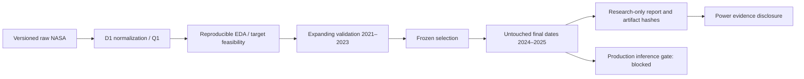
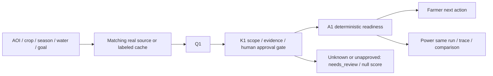
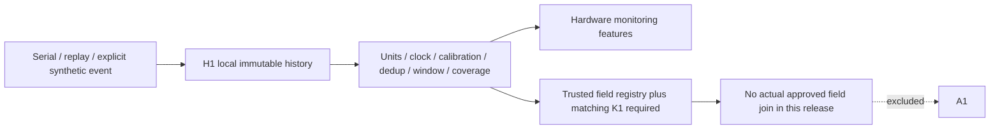

# AgroTwin V4.1 — system integrity and handoff
Single accountable owner: Hưng; all executable technical roles carried out by Codex. Continuation of V4, not a rebuild. Branch `build/agrotwin-v4.1-single-owner`. Baseline preserved: product c9edd22, lab b7be1e6, docs2f99462. WIP ZIP/SHA backup: C:/Users/ghcoo/.codex/project-memory/agrotwin-v41/20261114T093058Z. Prior dirty planning files are deliberately excluded from these commits.

## Five separate statuses
| Domain | Status | Scope |
|---|---|---|
| SOFTWARE | SYSTEM_SOFTWARE_VERIFIED after final verification receipt | Real A1/API/shared Farmer/Power, H1 ingestion, source/QA/gates, build/browser/reconstruction |
| DATA QUALITY | Technical reconstruction PASS; source warning retained |132months raw→normalized; one rainfall source flag; field validation not inferred |
| ML/E1 | ML_EXPERIMENT_VALIDATED; model RESEARCH_ONLY | Internal temporal24month final holdout distinct from validation; no production inference consumer |
| AGRONOMIC SCIENCE | SCIENTIFIC_APPROVAL_PENDING | Two provisional source-backed review packets, six production rules remain draft |
| HARDWARE/REAL-USER EVIDENCE | PHYSICAL_DEVICE_NOT_TESTED; USER_STUDY_NOT_DONE | Synthetic/mock/replay software tested; no calibration/field deployment or farmer study fabricated |

## Connected lanes and explicit nonjoins

## Actual implementation
Lab: `neurax/agrotwin/research.py` offline EDA + leakage-safe experiment reusing lag builder/HGB family; `inventory.py` actual local dataset hashes + raw reconstruction; `h1.py` bounded ingestion/history/quality features; API route POST /v1/h1/ingest; A1 next-action ownership updated. pyproject research extra declares plotting/thread control. Production crop rules unchanged.
Product: Power ResearchEvidence schema validates real report, displays explicit RESEARCH_ONLY/fallback/download; Hardware Pipeline explicitly syncs100events to server and shows flags/A1 exclusion. Farmer next actions precede references and input disclosure has one primary Analyze action. Shared A1, sources, existing map, serial/replay and offline guards retained. Curated research report shipped, weights/raw/private imagery excluded.
Docs: current execution authority bridge in neurax-docs; this evidence collection includes dataset/EDA/E1/K1/H1/UX/test/runbook. Existing historical documents preserved without pretending previous reviewers approved current claims.

## Evidence and commands
[Dataset inventory](DATASET_MANIFEST.md), [EDA](EDA_FINDINGS.md), [model/E1](MODEL_EXPERIMENTS_E1.md), [K1 packet](K1_REVIEW_PACKET.md), [H1](H1_INTEGRATION_REPORT.md), [UX](UX_DECISION_REVIEW.md), [verification](FULL_SYSTEM_VERIFICATION.md), [startup/reproduction/pitch](DEMO_AND_REPRO_RUNBOOK.md). Exact generated report/hash/tables/plot under evidence/. E1 is retrospective source-grid forecasting, not crop decision accuracy.

Start one command from product/frontend: `./Start-AgroTwin.ps1`; URL http://127.0.0.1:5174. Stop `./Stop-AgroTwin.ps1`. No accounts, purchases, cloud or physical probe needed. All temporary owned services are stopped at handoff. No push, public deploy or external message performed. Local commit identifiers are recorded in the final verification receipt; use git log on this branch for the documentation commit itself.

## Objective external limits
1. Genuine agronomic applicability approval and local crop/soil/water/calendar measurements are absent. Hưng decides qualified reviewers/evidence collection; current fallback is a fully executed needs_review trace, no crop winner.
2. No real calibrated device/log or verified deployment. Hardware ingestion works on software fixtures; actual bench/field claims need physical evidence. pH equipment remains unconfirmed.
3. Actual farmer comprehension has not been studied. Browser/Axe/persona review do not establish usability or yield/water benefits.

No ordinary implementation is waiting for former team-role approval. Optional production inference, field join, cloud/public release, purchases and nationwide expansion remain deliberately closed until their evidence/authorization is available. User impact demonstrated: identify which local facts and rule applicability must be checked before replacing a rice season; no optimal-crop or economic/soil-outcome guarantee.

Implementation commits: lab bd8e6a8 +05e31b6; product e1ba167; docs d2ebf66. Full hashes and pre-documentation working tree snapshot in evidence/verification.json. Documentation commit: git log -1 -- docs/execution/v4.1/SYSTEM_INTEGRITY_REPORT.md. All18pre-existing tracked WIP files match the preflight SHA backup.
